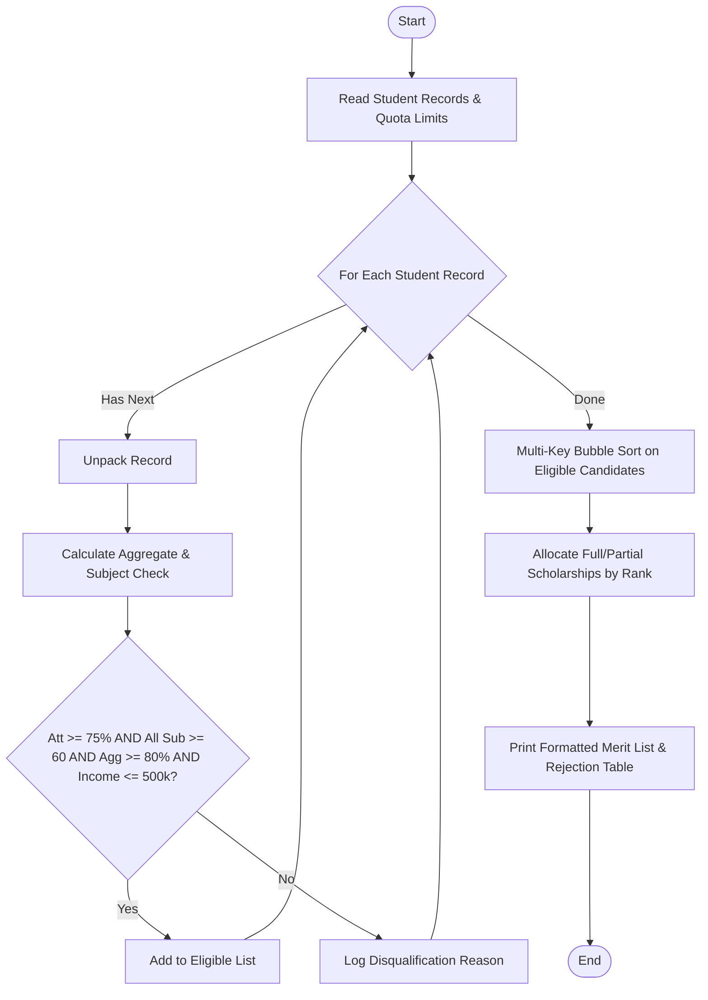

# Case Study 01: University Scholarship Allocation System

## 1. Problem Statement
Universities receive hundreds of applications for merit-cum-means scholarships. Evaluating applicants manually introduces bias, delays, and errors in tie-breaking. A system is needed to evaluate applicants based on aggregate marks, subject-wise minimum thresholds, attendance records, and annual household income, rank eligible students, and allocate scholarships according to predefined tie-breaking rules.

## 2. Objectives
- Automatically filter applicants based on minimum attendance ($\ge 75\%$), subject-wise scores ($\ge 60$ per subject), aggregate score ($\ge 80\%$), and family income ($\le \text{Rs. } 5,00,000$).
- Implement deterministic multi-key tie-breaking: Aggregate Percentage $\rightarrow$ Attendance Percentage $\rightarrow$ Lower Family Income $\rightarrow$ Student ID.
- Categorize awards into Full Scholarships, Partial Scholarships, and Merit Certificates based on available quotas.

## 3. Assumptions
- Marks are provided out of 100 for each course.
- Incomes are declared as non-negative integer values.
- Available scholarship seats are fixed positive integers.
- All records follow the specified tuple format `(id, name, marks_list, attendance, income)`.

## 4. Algorithm
1. Initialize empty lists for `eligible_students` and `rejected_students`.
2. For each student record in `student_records`:
   a. Unpack the tuple into `s_id`, `s_name`, `marks_list`, `attendance`, `income`.
   b. Calculate total marks and aggregate percentage.
   c. Verify if all subject marks are $\ge 60$.
   d. Check if attendance $\ge 75\%$, aggregate $\ge 80\%$, and income $\le 5,00,000$.
   e. If all conditions pass, append `[aggregate, attendance, -income, s_id, s_name, marks_list, income]` to `eligible_students`.
   f. Otherwise, record the student and disqualification reasons in `rejected_students`.
3. Sort `eligible_students` using multi-tier comparison (aggregate DESC, attendance DESC, income ASC, s_id ASC).
4. Iterate through ranked candidates and assign Full Scholarship, Partial Scholarship, or Merit recognition based on seat quotas.
5. Display the award manifest and rejection summary report.

## 5. Flowchart


## 6. Pseudocode
```text
BEGIN
    SET eligible_students = []
    SET rejected_students = []
    
    FOR EACH (s_id, s_name, marks_list, attendance, income) IN student_records DO
        total_marks = SUM(marks_list)
        aggregate = total_marks / LENGTH(marks_list)
        passed_subjects = TRUE
        
        FOR EACH mark IN marks_list DO
            IF mark < 60 THEN passed_subjects = FALSE
        END FOR
        
        reasons = []
        IF attendance < 75.0 THEN APPEND "Low Attendance" TO reasons
        IF NOT passed_subjects THEN APPEND "Subject < 60" TO reasons
        IF aggregate < 80.0 THEN APPEND "Aggregate < 80%" TO reasons
        IF income > 500000 THEN APPEND "Income Exceeded" TO reasons
        
        IF LENGTH(reasons) == 0 THEN
            APPEND [aggregate, attendance, -income, s_id, s_name, income] TO eligible_students
        ELSE
            APPEND (s_id, s_name, aggregate, reasons) TO rejected_students
        END IF
    END FOR
    
    SORT eligible_students BY aggregate DESC, attendance DESC, -income DESC, s_id ASC
    DISPLAY Allocated Scholarships and Disqualification Summary
END
```

## 7. Python Source Code
Refer to the complete script in [`scholarship_allocation.py`](file:///c:/Users/Harsha/Downloads/New%20folder/Python-Activity-Based-Learning/Case_Study_01_University_Scholarship/scholarship_allocation.py).

## 8. Test Cases
| Test ID | Input (Student Details) | Expected Outcome | Purpose |
| :--- | :--- | :--- | :--- |
| **TC-01** | `STU107`: Agg 93%, Att 95%, Income 3.5L | Rank 1 (Full Scholarship) | Validates top academic performer |
| **TC-02** | `STU101` & `STU104`: Same Agg (88.75%) & Att (92.5%), Incomes 3.2L vs 2.4L | `STU104` ranked higher due to lower income | Validates income tie-breaking |
| **TC-03** | `STU103`: Agg 93%, Att 72% | Disqualified | Validates attendance cutoff boundary (< 75%) |
| **TC-04** | `STU105`: Agg 82%, Sub2 = 58 | Disqualified | Validates subject-wise minimum threshold (< 60) |
| **TC-05** | `STU106`: Agg 83%, Income 6.2L | Disqualified | Validates means-tested financial ceiling |

## 9. Sample Output Run
```text
================================================================================
           UNIVERSITY SCHOLARSHIP ALLOCATION SYSTEM
================================================================================
Criteria:
  1. Minimum Attendance >= 75%
  2. Subject-wise minimum score >= 60 in all subjects
  3. Aggregate Percentage >= 80%
  4. Annual Family Income <= Rs. 5,00,000
Tie-Breaking Hierarchy: Aggregate % -> Attendance % -> Lower Income -> Student ID
--------------------------------------------------------------------------------

[+] RANKED ELIGIBLE CANDIDATES & SCHOLARSHIP AWARDS:
Rank  ID         Name             Agg %    Att %    Income (Rs)  Scholarship Category
--------------------------------------------------------------------------------
1     STU107     Ishan Joshi      93.00    95.0     350000       FULL SCHOLARSHIP (100% Tuition Waiver)
2     STU104     Ananya Sen       88.75    92.5     240000       FULL SCHOLARSHIP (100% Tuition Waiver)
3     STU101     Aarav Sharma     88.75    92.5     320000       PARTIAL SCHOLARSHIP (50% Tuition Waiver)
4     STU108     Meera Nair       85.00    90.0     450000       PARTIAL SCHOLARSHIP (50% Tuition Waiver)
5     STU102     Diya Patel       84.25    88.0     280000       MERIT CERTIFICATE (Quota Filled)

[-] DISQUALIFIED CANDIDATES SUMMARY:
ID         Name             Agg %    Reason(s) for Rejection
--------------------------------------------------------------------------------
STU103     Rohan Verma      93.00    Low attendance (72.0%)
STU105     Kabir Mehta      82.00    Subject score < 60
STU106     Sneha Reddy      83.00    Income exceeds limit (Rs. 620000)
================================================================================
```

## 10. Conclusion
The University Scholarship Allocation System successfully automates candidate screening using nested loops, lists, and multi-tier sorting algorithms. All constraints are enforced transparently, eliminating discretion in financial aid distribution.
