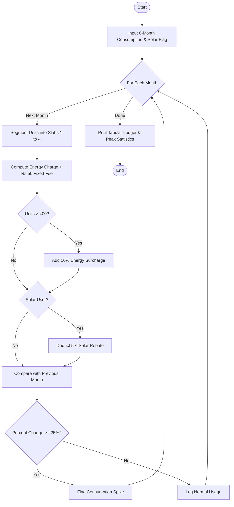

# Case Study 02: Progressive Electricity Billing and Trend Comparison

## 1. Problem Statement
Utility companies implement progressive stepped tariffs to promote energy conservation. Calculating accurate bills requires multi-slab charging, fixed meter maintenance fees, high-consumption penalties (surcharges), and green energy incentives (rebates). Furthermore, consumers require monthly trend analytics to detect anomalies, such as faulty meters or seasonal consumption spikes.

## 2. Objectives
- Compute tiered electricity charges across 4 distinct consumption brackets.
- Apply conditional fixed fees, 10% surcharges on heavy usage ($> 400$ units), and 5% renewable energy rebates.
- Analyze 6-month historical billing to identify spikes ($> 25\%$ increase) and summarize peak/minimum consumption periods.

## 3. Assumptions
- Electricity consumption readings are non-negative integers.
- Slabs apply progressively (units are segmented into buckets rather than charging the entire sum at the highest slab).
- A 10% surcharge applies strictly to the energy charge when units exceed 400.
- A 5% rebate applies to the energy charge for solar-equipped premises.

## 4. Algorithm
1. Receive monthly consumption data list `[m1, m2, ..., mn]` and solar status boolean.
2. For each monthly unit reading:
   a. Compute progressive energy charge:
      - Units above 500: rate Rs 7.50/unit
      - Units 201 to 500: rate Rs 5.50/unit
      - Units 101 to 200: rate Rs 3.00/unit
      - Units 0 to 100: rate Rs 1.50/unit
   b. Add fixed charge (Rs 50.0).
   c. If units $> 400$, calculate surcharge $= 10\% \times \text{energy charge}$.
   d. If solar user, calculate rebate $= 5\% \times \text{energy charge}$.
   e. Total Bill $= \text{Fixed Charge} + \text{Energy Charge} + \text{Surcharge} - \text{Rebate}$.
3. For trend analysis:
   a. Compare current month units against previous month.
   b. If percentage rise $\ge 25\%$, flag as `SPIKE (+X%)`.
   c. If percentage decline $\le -25\%$, flag as `DROP (-X%)`.
4. Calculate cumulative units, cumulative billing, monthly averages, and peak/trough months.
5. Print the formatted ledger.

## 5. Flowchart


## 6. Pseudocode
```text
BEGIN
    SET fixed_charge = 50.0
    FOR EACH units IN monthly_readings DO
        energy_charge = 0
        rem = units
        
        IF rem > 500 THEN energy_charge += (rem - 500) * 7.50; rem = 500
        IF rem > 200 THEN energy_charge += (rem - 200) * 5.50; rem = 200
        IF rem > 100 THEN energy_charge += (rem - 100) * 3.00; rem = 100
        IF rem > 0 THEN energy_charge += rem * 1.50
        
        surcharge = IF units > 400 THEN energy_charge * 0.10 ELSE 0
        rebate = IF has_solar THEN energy_charge * 0.05 ELSE 0
        total = fixed_charge + energy_charge + surcharge - rebate
        
        IF prev_units != NULL AND ((units - prev_units) / prev_units) >= 0.25 THEN
            PRINT "SPIKE DETECTED"
        END IF
        prev_units = units
    END FOR
END
```

## 7. Python Source Code
Refer to the complete script in [`electricity_billing.py`](file:///c:/Users/Harsha/Downloads/New%20folder/Python-Activity-Based-Learning/Case_Study_02_Progressive_Electricity_Billing/electricity_billing.py).

## 8. Test Cases
| Test ID | Input Units | Solar | Expected Energy Charge | Expected Surcharge | Expected Total | Purpose |
| :--- | :--- | :--- | :--- | :--- | :--- | :--- |
| **TC-01** | 80 Units | No | $80 \times 1.50 = 120.0$ | $0.00$ | $50 + 120 = 170.00$ | Tests lowest tier |
| **TC-02** | 150 Units | No | $150 + 150 = 300.0$ | $0.00$ | $50 + 300 = 350.00$ | Tests second tier |
| **TC-03** | 480 Units | Yes | $150 + 300 + 1540 = 1990.0$ | $199.00$ (10%) | $50 + 1990 + 199 - 99.5 = 2139.50$ | Tests surcharge and solar rebate combined |
| **TC-04** | Sequence: 240 to 480 | - | $+100\%$ change | - | Flagged as `SPIKE (+100.0%)` | Validates anomaly detection |

## 9. Sample Output Run
```text
=====================================================================================
      PROGRESSIVE ELECTRICITY BILL & TREND ANALYSIS: CON-7842 - Vikram Singhania
=====================================================================================
Tariff Slabs: 0-100: Rs 1.50 | 101-200: Rs 3.00 | 201-500: Rs 5.50 | >500: Rs 7.50
Fixed Charge: Rs 50 | High Usage Surcharge (>400 units): 10% | Solar Rebate: 5%
-------------------------------------------------------------------------------------
Month      Units    Energy (Rs)  Surcharge  Rebate   Total (Rs)   Trend Alert
-------------------------------------------------------------------------------------
Jan        120      210.00       0.00       10.50    249.50       Normal
Feb        140      270.00       0.00       13.50    306.50       Normal
Mar        180      390.00       0.00       19.50    420.50       SPIKE (+28.6%)
Apr        240      670.00       0.00       33.50    686.50       SPIKE (+33.3%)
May        480      1990.00      199.00     99.50    2139.50      SPIKE (+100.0%)
Jun        520      2250.00      225.00     112.50   2412.50      Normal
-------------------------------------------------------------------------------------
Total Consumption: 1680 Units | Total Billed: Rs. 6215.00
Average Monthly Consumption: 280.0 Units | Average Monthly Bill: Rs. 1035.83
Peak Consumption: Jun (520 units)
Lowest Consumption: Jan (120 units)
=====================================================================================
```

## 10. Conclusion
The progressive billing engine models non-linear tariffs and handles multi-tier conditional operations. Historical trend analysis equips consumer and utility providers with proactive consumption visibility.
