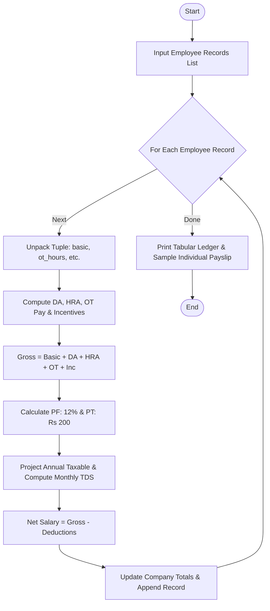

# Case Study 03: Employee Payroll and Deduction Analysis System

## 1. Problem Statement
Manual processing of employee salaries is prone to computational discrepancies in allowance multipliers, progressive tax brackets, and mandatory compliance deductions. An enterprise requires an automated payroll calculation engine to parse employee compensation components, compute tiered income tax withholding (TDS), assess provident fund (PF) contributions, and generate formatted salary slips and corporate registers.

## 2. Objectives
- Compute variable allowances including Dearness Allowance (40%), House Rent Allowance (20%), Overtime (Rs. 350/hour), and tiered performance incentives.
- Deduct mandatory statutory withholdings: 12% PF, Rs. 200 Professional Tax, and progressive annual income tax slabs.
- Output high-readability tabular company payroll registers and individual employee salary slips.

## 3. Assumptions
- Basic pay is specified in Indian Rupees as a positive numeric quantity.
- Overtime hours are tracked accurately as integer increments.
- Standard deduction of Rs. 50,000 applies to annualized taxable income.
- Income tax is projected over a 12-month period and deducted as equal monthly TDS instalments.

## 4. Algorithm
1. Read list of employee records `(emp_id, emp_name, dept, basic_pay, ot_hours)`.
2. For each employee record:
   a. Compute allowances:
      - $\text{DA} = 0.40 \times \text{Basic}$
      - $\text{HRA} = 0.20 \times \text{Basic}$
      - $\text{OT Pay} = \text{Overtime Hours} \times 350.0$
      - $\text{Incentive} = 0.05 \times \text{Basic}$ (if $\text{Basic} > 50,000$) else $0.08 \times \text{Basic}$
   b. $\text{Gross Salary} = \text{Basic} + \text{DA} + \text{HRA} + \text{OT Pay} + \text{Incentive}$.
   c. Compute statutory deductions:
      - $\text{PF} = 0.12 \times \text{Basic}$
      - $\text{Professional Tax} = 200.0$
   d. Compute progressive Income Tax (TDS):
      - Projected annual taxable income $= (\text{Gross} \times 12) - 50,000$.
      - Slabs: 0% up to 3L; 5% between 3L and 6L; 10% between 6L and 10L; 20% above 10L.
      - $\text{Monthly TDS} = \text{Annual Tax} / 12$.
   e. $\text{Net Salary} = \text{Gross Salary} - (\text{PF} + \text{PT} + \text{TDS})$.
3. Track company-wide net payout, total TDS deposited, and total PF deposited.
4. Render corporate payroll register and single-employee itemized payslip.

## 5. Flowchart


## 6. Pseudocode
```text
BEGIN
    FOR EACH (id, name, dept, basic, ot) IN employees DO
        da = basic * 0.40
        hra = basic * 0.20
        ot_pay = ot * 350
        inc = basic * 0.05 IF basic > 50000 ELSE basic * 0.08
        gross = basic + da + hra + ot_pay + inc
        
        pf = basic * 0.12
        pt = 200
        
        annual_taxable = MAX(0, (gross * 12) - 50000)
        annual_tax = 0
        rem = annual_taxable
        IF rem > 1000000 THEN annual_tax += (rem - 1000000) * 0.20; rem = 1000000
        IF rem > 600000 THEN annual_tax += (rem - 600000) * 0.10; rem = 600000
        IF rem > 300000 THEN annual_tax += (rem - 300000) * 0.05; rem = 300000
        tds = annual_tax / 12
        
        net = gross - (pf + pt + tds)
        DISPLAY row
    END FOR
END
```

## 7. Python Source Code
Refer to the complete script in [`payroll_analysis.py`](file:///c:/Users/Harsha/Downloads/New%20folder/Python-Activity-Based-Learning/Case_Study_03_Employee_Payroll_Analysis/payroll_analysis.py).

## 8. Test Cases
| Test ID | Input Basic | OT Hours | Expected Gross | Expected PF | Expected Tax | Expected Net | Purpose |
| :--- | :--- | :--- | :--- | :--- | :--- | :--- | :--- |
| **TC-01** | Rs. 45,000 | 5 hrs | $45000 + 18000 + 9000 + 1750 + 3600 = 77,350$ | Rs. 5,400 | Approx Rs. 3,118.3 | Approx Rs. 68,631.7 | Lower bracket incentive (8%) |
| **TC-02** | Rs. 80,000 | 10 hrs | $80000 + 32000 + 16000 + 3500 + 4000 = 135,500$ | Rs. 9,600 | Approx Rs. 14,966.7 | Approx Rs. 110,733.3 | Higher bracket incentive (5%) & 20% tax slab |
| **TC-03** | Rs. 35,000 | 0 hrs | $35000 + 14000 + 7000 + 0 + 2800 = 58,800$ | Rs. 4,200 | Approx Rs. 1,570.0 | Approx Rs. 52,830.0 | Zero overtime validation |

## 9. Sample Output Run
```text
===================================================================================================================
                             CORPORATE PAYROLL & TAX DEDUCTION STATEMENT
===================================================================================================================
Allowances: DA = 40% | HRA = 20% | Overtime = Rs 350/hr | Incentive = 5% (if Basic > 50k) else 8%
Deductions: PF = 12% Basic | Professional Tax = Rs 200 | Progressive TDS based on Annual Projected
-------------------------------------------------------------------------------------------------------------------
Emp ID   Name               Dept         Basic     Gross      PF       PT     TDS       Total Ded  Net Salary 
-------------------------------------------------------------------------------------------------------------------
EMP01    Rajesh Khanna      Engineering  65000     115500.0   7800.0   200    11300.0   19300.0    96200.0    
EMP02    Sunita Nair        Marketing    45000     77350.0    5400.0   200    3985.0    9585.0     67765.0    
EMP03    Amitabh Sen        Operations   35000     66500.0    4200.0   200    2483.3    6883.3     59616.7    
EMP04    Priyanka Roy       HR           52000     85800.0    6240.0   200    5440.0    11880.0    73920.0    
EMP05    Tanmay Kulkarni    Engineering  80000     135500.0   9600.0   200    14966.7   24766.7    110733.3   
-------------------------------------------------------------------------------------------------------------------
Total Disbursed Net Salary: Rs. 408,235.00
Total Monthly TDS Deposited: Rs. 38,175.00 | Total PF Contribution: Rs. 33,240.00
===================================================================================================================
```

## 10. Conclusion
The employee payroll analysis engine successfully demonstrates arithmetic expressions, nested progressive tax conditionals, tuple unpacking, and formatted string reporting, ensuring fully audited payroll operations.
