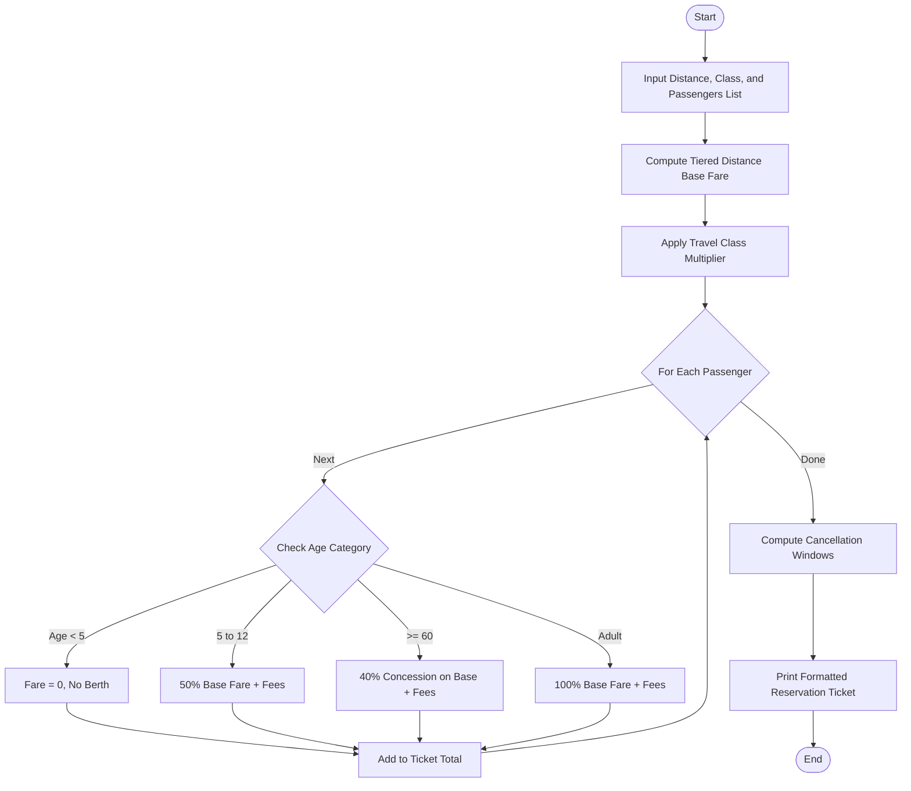

# Case Study 04: Railway Fare and Multi-Passenger Reservation Calculator

## 1. Problem Statement
Booking passenger rail tickets involves multi-dimensional variables including route distance brackets, class multipliers, age-dependent concessions, mandatory safety/superfast surcharges, and graded cancellation policies. The objective is to design a rule-based reservation engine that processes passenger rosters, computes tiered concessions, generates an itemized ticket, and projects cancellation refunds.

## 2. Objectives
- Compute distance-based slab pricing with tiered rates across 100 km, 500 km, and long-haul distances.
- Apply travel class multipliers (Sleeper 1.0x, 3AC 2.5x, 2AC 3.5x, 1AC 5.0x) with class reservation fees.
- Handle age-based concessions: Infants ($< 5$) Free, Children ($5-12$) 50% base fare, Senior Citizens ($\ge 60$) 40% concession.
- Calculate time-dependent cancellation penalties ($> 48\text{ hrs}$, $12-48\text{ hrs}$, $4-12\text{ hrs}$, $< 4\text{ hrs}$).

## 3. Assumptions
- Distance is supplied in whole kilometers.
- Fixed reservation fee and superfast charges apply only to fare-paying passengers with allocated berths.
- Infants under 5 years travel free without separate berth allocation.
- Cancellation timing is evaluated in hours prior to scheduled departure.

## 4. Algorithm
1. Receive distance, travel class, and list of passenger tuples `(name, age, gender, berth_pref)`.
2. Compute base distance fare:
   - $0-100\text{ km} \rightarrow \text{Rs } 0.75/\text{km}$
   - $101-500\text{ km} \rightarrow \text{Rs } 0.55/\text{km}$
   - $> 500\text{ km} \rightarrow \text{Rs } 0.40/\text{km}$
3. Multiply by travel class factor (e.g. 2.5 for 3AC) to yield class base fare.
4. For each passenger:
   a. If age $< 5$: Total $= 0$.
   b. If $5 \le \text{age} \le 12$: Base $= 0.50 \times \text{class base}$; Total $= \text{Base} + \text{Res Fee} + \text{SF Fee}$.
   c. If $\text{age} \ge 60$: Base $= 0.60 \times \text{class base}$; Total $= \text{Base} + \text{Res Fee} + \text{SF Fee}$.
   d. Otherwise: Base $= \text{class base}$; Total $= \text{Base} + \text{Res Fee} + \text{SF Fee}$.
5. Accumulate total ticket amount and berth count.
6. Evaluate cancellation refund table across standard window scenarios.
7. Print itemized invoice.

## 5. Flowchart


## 6. Pseudocode
```text
BEGIN
    base_km = CalculateDistanceSlabs(distance)
    class_base = base_km * class_multiplier
    
    total_bill = 0
    FOR EACH (name, age, gender, berth) IN passengers DO
        IF age < 5 THEN
            p_fare = 0
        ELSE IF age <= 12 THEN
            p_fare = (0.50 * class_base) + res_fee + sf_charge
        ELSE IF age >= 60 THEN
            p_fare = (0.60 * class_base) + res_fee + sf_charge
        ELSE
            p_fare = class_base + res_fee + sf_charge
        END IF
        total_bill += p_fare
    END FOR
    
    DISPLAY Reservation Ticket and Cancellation Schedule
END
```

## 7. Python Source Code
Refer to the complete script in [`railway_fare.py`](file:///c:/Users/Harsha/Downloads/New%20folder/Python-Activity-Based-Learning/Case_Study_04_Railway_Fare_Calculator/railway_fare.py).

## 8. Test Cases
| Test ID | Category | Age | Distance / Class | Expected Concession | Purpose |
| :--- | :--- | :--- | :--- | :--- | :--- |
| **TC-01** | Infant | 3 yrs | 840 km / 3A | 100% discount (Rs 0.00) | Child under 5 free travel |
| **TC-02** | Child | 8 yrs | 840 km / 3A | 50% off base + fees | Child fare validation |
| **TC-03** | Senior Citizen | 63 yrs | 840 km / 3A | 40% off base + fees | Senior citizen concession |
| **TC-04** | Cancellation | - | 72 hrs prior | Flat clerkage charge (Rs 180) | Early cancellation rules |
| **TC-05** | Cancellation | - | 2 hrs prior | 100% penalty (Rs 0 refund) | Late cancellation lock |

## 9. Sample Output Run
```text
==========================================================================================
                     INDIAN RAILWAYS PASSENGER RESERVATION INVOICE
==========================================================================================
PNR Number    : 248-9102847          Train: 12951 Mumbai Rajdhani Express
Distance      : 840 KM               Class: 3A (Multiplier: 2.5x)
------------------------------------------------------------------------------------------
No.  Passenger Name       Age   Gender   Concession Type      Base Fare    Total (Rs)
------------------------------------------------------------------------------------------
1    Rameshwar Gupta      63    Male     Senior Citizen (40% Off) 646.50       731.50    
2    Savitri Gupta        60    Female   Senior Citizen (40% Off) 646.50       731.50    
3    Alok Gupta           34    Male     Standard Adult       1077.50      1162.50   
4    Pooja Gupta          31    Female   Standard Adult       1077.50      1162.50   
5    Aarav Gupta          8     Male     Child (50% Base)     538.75       623.75    
6    Anvi Gupta           3     Female   Infant (Free)        0.00         0.00      
------------------------------------------------------------------------------------------
Total Passengers: 6 (Berths Allocated: 5) | GRAND TOTAL: Rs. 4,411.75
==========================================================================================

--- CANCELLATION CHARGES & REFUND ESTIMATION ---
Cancelled 72 hrs prior -> Cancellation Penalty: Rs.   180.00 | Refund Payable: Rs.  4231.75
Cancelled 24 hrs prior -> Cancellation Penalty: Rs.  1102.94 | Refund Payable: Rs.  3308.81
Cancelled  6 hrs prior -> Cancellation Penalty: Rs.  2205.88 | Refund Payable: Rs.  2205.88
Cancelled  2 hrs prior -> Cancellation Penalty: Rs.  4411.75 | Refund Payable: Rs.     0.00
==========================================================================================
```

## 10. Conclusion
The Railway Fare and Reservation Calculator demonstrates robust modeling of real-world transport fare matrices, age validations, class multipliers, and time-bracketed penalty logic using core Python lists and tuples.
