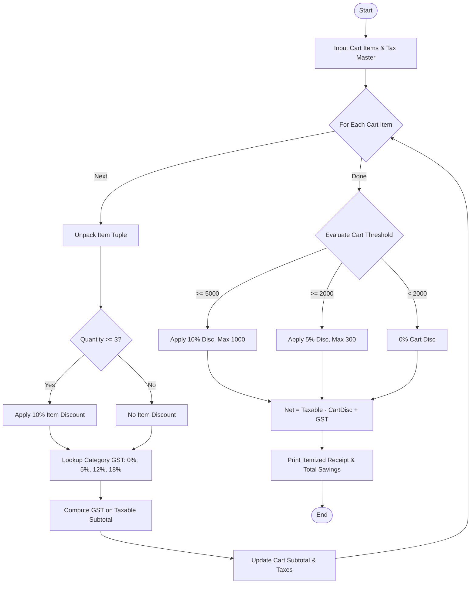

# Case Study 05: Retail Billing System with Multiple Discount Rules

## 1. Problem Statement
Modern Point-of-Sale (POS) systems require multi-level pricing pipelines that concurrently process product quantities, selective category sales taxes (GST), quantity-triggered promotional cuts, and progressive cart threshold discounts subject to strict concession ceilings. The objective is to build a deterministic retail billing system that outputs an itemized fiscal receipt.

## 2. Objectives
- Compute item-level gross amounts and apply volume discounts (10% off for $\text{quantity} \ge 3$).
- Map items to statutory tax categories (Grocery 0%, Apparel 5%, Cosmetics 12%, Electronics 18%).
- Apply tiered cart threshold discounts:
  - Subtotal $\ge \text{Rs } 5,000 \rightarrow 10\%$ discount (capped at Rs 1,000).
  - Subtotal $\ge \text{Rs } 2,000 \rightarrow 5\%$ discount (capped at Rs 300).
- Output an itemized commercial invoice with total tax liabilities and customer savings.

## 3. Assumptions
- Unit prices and quantities are strictly positive.
- Quantity discounts are calculated on pre-tax base amounts.
- Category taxes apply to post-item-discount taxable merchandise amounts.
- Overall cart discounts are bounded by prescribed concession limits.

## 4. Algorithm
1. Receive cart items list containing `(item_code, name, category, unit_price, quantity)`.
2. For each item:
   a. Compute $\text{item gross} = \text{unit price} \times \text{quantity}$.
   b. If $\text{quantity} \ge 3$, set $\text{item discount} = 0.10 \times \text{item gross}$; else $0$.
   c. $\text{Taxable value} = \text{item gross} - \text{item discount}$.
   d. Lookup category tax rate from category rules list.
   e. Compute $\text{GST amount} = \text{Taxable value} \times \text{GST rate}$.
   f. Line total $= \text{Taxable value} + \text{GST amount}$.
3. Calculate cart-level discount:
   - If total taxable $\ge 5000$: discount $= \min(10\% \times \text{taxable}, 1000)$.
   - Else if total taxable $\ge 2000$: discount $= \min(5\% \times \text{taxable}, 300)$.
4. Compute $\text{Net Payable} = (\text{Total Taxable} - \text{Cart Discount}) + \text{Total GST}$.
5. Print itemized receipt with savings summary.

## 5. Flowchart


## 6. Pseudocode
```text
BEGIN
    subtotal_taxable = 0
    total_gst = 0
    FOR EACH (code, name, cat, price, qty) IN cart DO
        gross = price * qty
        disc = (gross * 0.10) IF qty >= 3 ELSE 0
        taxable = gross - disc
        gst_rate = LOOKUP_RATE(cat)
        gst = taxable * gst_rate
        
        subtotal_taxable += taxable
        total_gst += gst
        DISPLAY item_line
    END FOR
    
    cart_disc = 0
    IF subtotal_taxable >= 5000 THEN
        cart_disc = MIN(subtotal_taxable * 0.10, 1000)
    ELSE IF subtotal_taxable >= 2000 THEN
        cart_disc = MIN(subtotal_taxable * 0.05, 300)
    END IF
    
    grand_total = (subtotal_taxable - cart_disc) + total_gst
    DISPLAY Invoice Totals
END
```

## 7. Python Source Code
Refer to the complete script in [`retail_billing.py`](file:///c:/Users/Harsha/Downloads/New%20folder/Python-Activity-Based-Learning/Case_Study_05_Retail_Billing_Discount/retail_billing.py).

## 8. Test Cases
| Test ID | Item & Qty | Category | Expected Tax Rate | Expected Discount | Purpose |
| :--- | :--- | :--- | :--- | :--- | :--- |
| **TC-01** | Almonds (Qty 3) | Grocery | 0% GST | 10% bulk discount applied | Volume discount on essential goods |
| **TC-02** | Wireless Buds (Qty 1) | Electronics | 18% GST | 0% item discount | High-tier category tax |
| **TC-03** | Shampoo (Qty 4) | Cosmetics | 12% GST | 10% bulk discount applied | Mid-tier tax with bulk savings |
| **TC-04** | Cart Taxable: Rs 5,200 | - | - | 10% disc = Rs 520 (< 1000 cap) | Upper threshold discount |
| **TC-05** | Cart Taxable: Rs 15,000 | - | - | 10% disc capped at Rs 1,000 | Maximum concession cap boundary |

## 9. Sample Output Run
```text
=========================================================================================================
                                   RELIANCE SMART HYPERMARKET
                              TAX INVOICE & RETAIL RECEIPT
=========================================================================================================
Customer Name : Sunita Deshmukh                Date: 2026-11-24
Discount Policy: Bulk Buy (Qty >= 3): 10% Off Item | Cart > 2k: 5% Off | Cart > 5k: 10% Off (Max 1k)
---------------------------------------------------------------------------------------------------------
Code     Item Description       Category       Qty   Price    Item Disc   Taxable    GST%   GST (Rs)  Total (Rs)
---------------------------------------------------------------------------------------------------------
PRD01    Basmati Rice 5kg       Grocery        2     450.00   0.00        900.00     0 %    0.00      900.00    
PRD02    Organic Almonds 500g   Grocery        3     380.00   114.00      1026.00    0 %    0.00      1026.00   
PRD03    Cotton Polo T-Shirt    Apparel        2     899.00   0.00        1798.00    5 %    89.90     1887.90   
PRD04    Wireless Bluetooth Buds Electronics    1     1499.00  0.00        1499.00    18%    269.82    1768.82   
PRD05    Natural Herbal Shampoo Cosmetics      4     275.00   110.00      990.00     12%    118.80    1108.80   
---------------------------------------------------------------------------------------------------------
Gross Items Subtotal                          : Rs.    6566.00
Item-Level Quantity Savings                   : Rs. -   224.00
Taxable Merchandise Value                     : Rs.    6213.00
Cart Threshold Discount [10% Super Saver (Capped at Rs 1000)] : Rs. -   621.30
Total Applicable GST Tax                      : Rs.     478.52
=========================================================================================================
NET PAYABLE AMOUNT (ROUNDED)                  : Rs.    6070.00
TOTAL CUSTOMER SAVINGS TODAY                  : Rs.     845.30  🎉
=========================================================================================================
```

## 10. Conclusion
The POS billing engine utilizes nested lists, tuples, and multi-tier conditionals to accurately compute itemized taxes, volume incentives, and capped threshold discounts matching enterprise retail requirements.
