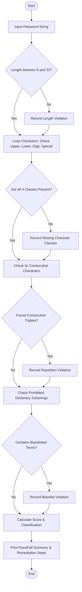

# Case Study 07: Password Policy Validation Engine

## 1. Problem Statement
Authentication endpoints are susceptible to brute-force and dictionary attacks when users select weak credentials. Organizations mandate deterministic validation engines that inspect password strings against multi-category entropy policies, character class distributions, repetition limits, and blacklisted substrings, providing actionable remediation feedback for every violated constraint.

## 2. Objectives
- Validate candidate passwords against minimum length (8-32 characters).
- Enforce character diversity across uppercase, lowercase, numeric digits, and special characters.
- Detect and prevent repetition flaws (no 3 or more consecutive identical characters).
- Block common dictionary substrings (`password`, `admin`, `1234`, `qwerty`, `welcome`).
- Output diagnostic compliance classifications and numeric strength scores.

## 3. Assumptions
- Password inputs are string literals.
- Evaluation is case-insensitive for dictionary and prohibited pattern detection.
- Special characters are defined from the standard ASCII symbol set.

## 4. Algorithm
1. Receive candidate password string.
2. Initialize `failed_rules` list.
3. Check length:
   - If length $< 8$, record short length fault.
   - If length $> 32$, record excessive length fault.
4. Iterate through string and track flags for uppercase, lowercase, digits, and special characters.
   - For any missing character class, record respective fault.
5. Check for 3 consecutive identical characters using sliding window index $i, i+1, i+2$.
   - If found, flag repetition violation.
6. Convert string to lowercase and inspect against blacklisted dictionary terms.
   - If found, record prohibited term fault.
7. Compute composite score: $\text{Score} = \max(0, 100 - (18 \times \text{Number of Faults}))$.
8. Classify strength as EXCELLENT, STRONG, MODERATE, or WEAK.
9. Output diagnostic report.

## 5. Flowchart


## 6. Pseudocode
```text
BEGIN
    failures = []
    IF LENGTH(pw) < 8 OR LENGTH(pw) > 32 THEN APPEND "Length violation"
    
    has_up = FALSE; has_low = FALSE; has_dig = FALSE; has_spec = FALSE
    FOR EACH ch IN pw DO
        IF ch IN 'A'..'Z' THEN has_up = TRUE
        IF ch IN 'a'..'z' THEN has_low = TRUE
        IF ch IN '0'..'9' THEN has_dig = TRUE
        IF ch IN SPECIALS THEN has_spec = TRUE
    END FOR
    
    IF NOT (has_up AND has_low AND has_dig AND has_spec) THEN APPEND "Missing character class"
    
    FOR i FROM 0 TO LENGTH(pw) - 3 DO
        IF pw[i] == pw[i+1] == pw[i+2] THEN APPEND "Excess repetition"; BREAK
    END FOR
    
    FOR EACH word IN BLACKLIST DO
        IF word IN LOWER(pw) THEN APPEND "Prohibited word"
    END FOR
    
    score = MAX(0, 100 - (LENGTH(failures) * 18))
    DISPLAY failures AND score
END
```

## 7. Python Source Code
Refer to the complete script in [`password_validator.py`](file:///c:/Users/Harsha/Downloads/New%20folder/Python-Activity-Based-Learning/Case_Study_07_Password_Policy_Validation/password_validator.py).

## 8. Test Cases
| Test ID | Input Password | Expected Status | Violated Rules | Purpose |
| :--- | :--- | :--- | :--- | :--- |
| **TC-01** | `pass123` | `[FAIL]` | Length < 8, No uppercase, No special char, Blacklisted `pass` | Multi-fault detection |
| **TC-02** | `Administrator2026!` | `[FAIL]` | Blacklisted `admin` | Substring blacklist enforcement |
| **TC-03** | `HellooooWorld123!` | `[FAIL]` | 3x repeated character `oooo` | Repetition constraint |
| **TC-04** | `K9#mQ2$xP8@vL1` | `[PASS]` | None (Score 100) | Complex random entropy |
| **TC-05** | `MySuperSecretP@ssw0rd2026` | `[PASS]` | None (Score 100) | Passphrase standard validation |

## 9. Sample Output Run
```text
===============================================================================================
                      ENTERPRISE PASSWORD POLICY AUDIT ENGINE
===============================================================================================
Policy Rules: Length: 8-32 | Uppercase + Lowercase + Digit + Special | No 3x repeat | No dictionary terms
-----------------------------------------------------------------------------------------------
Password Sample : 'pass123'
Audit Status    : [FAIL] Score: 28/100 | Classification: WEAK / REJECTED
Failed Rules    :
   • Length too short (7 chars; minimum required is 8)
   • Missing at least one UPPERCASE letter (A-Z)
   • Missing at least one SPECIAL character (!@#$%^&*()_+-=[]{}|;:,.<>?/~`...)
   • Contains prohibited common dictionary word(s): pass
-----------------------------------------------------------------------------------------------
Password Sample : 'Administrator2026!'
Audit Status    : [FAIL] Score: 82/100 | Classification: MODERATE (Needs Remediation)
Failed Rules    :
   • Contains prohibited common dictionary word(s): admin
-----------------------------------------------------------------------------------------------
Password Sample : 'K9#mQ2$xP8@vL1'
Audit Status    : [PASS] Score: 100/100 | Classification: EXCELLENT / ENTERPRISE COMPLIANT
Policy Checks   : All 7 enterprise cryptographic constraints satisfied.
-----------------------------------------------------------------------------------------------
Password Sample : 'HellooooWorld123!'
Audit Status    : [FAIL] Score: 82/100 | Classification: MODERATE (Needs Remediation)
Failed Rules    :
   • Contains 3 or more consecutive identical characters ('ooo')
-----------------------------------------------------------------------------------------------
Password Sample : 'MySuperSecretP@ssw0rd2026'
Audit Status    : [PASS] Score: 100/100 | Classification: EXCELLENT / ENTERPRISE COMPLIANT
Policy Checks   : All 7 enterprise cryptographic constraints satisfied.
-----------------------------------------------------------------------------------------------
Password Sample : '12345678'
Audit Status    : [FAIL] Score: 28/100 | Classification: WEAK / REJECTED
Failed Rules    :
   • Missing at least one UPPERCASE letter (A-Z)
   • Missing at least one LOWERCASE letter (a-z)
   • Missing at least one SPECIAL character (!@#$%^&*()_+-=[]{}|;:,.<>?/~`...)
   • Contains prohibited common dictionary word(s): 1234
-----------------------------------------------------------------------------------------------
```

## 10. Conclusion
This case study implements industrial credential validation using string scanning, boundary conditions, sliding-window repetition detection, and dictionary substring verification, adhering strictly to the core syllabus.
