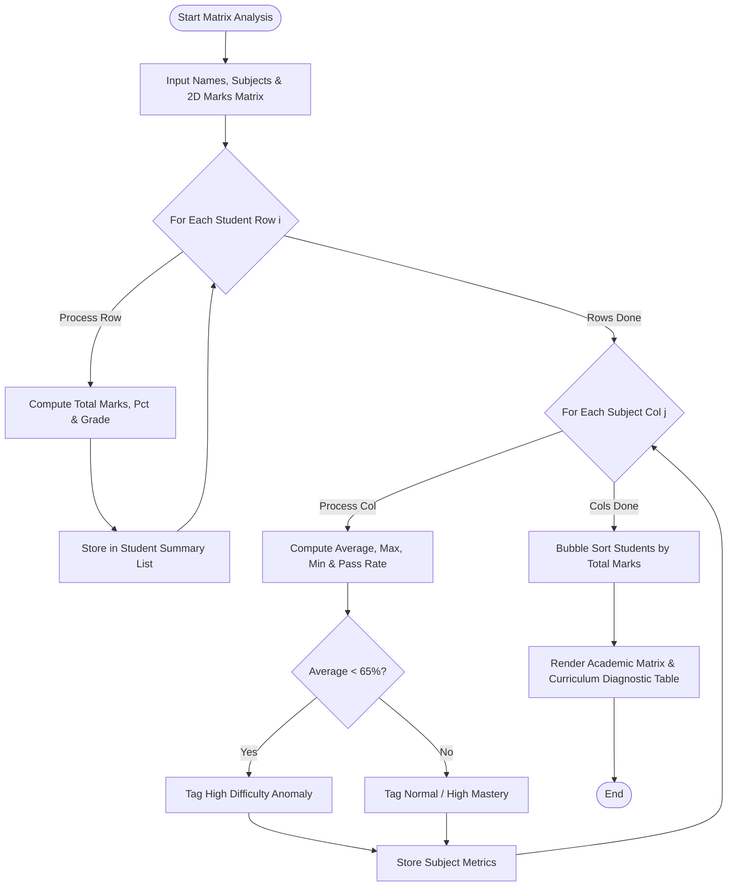

# Case Study 08: Student Performance Trend and Marks Matrix Analysis

## 1. Problem Statement
Educational institutions require automated multi-dimensional matrix analytics to assess both individual student progress and cohort-wide subject curriculum health. The system must process a 2D nested list representation of marks across $M$ students and $N$ subjects, computing row-wise student rankings, column-wise subject difficulty metrics, and outlier alerts for rigorous academic auditing.

## 2. Objectives
- Represent student evaluation records using standard 2D nested list matrix primitives.
- Perform row-wise aggregation: Total marks, percentage, and letter grading for each student.
- Perform column-wise aggregation: Subject averages, highest/lowest scores, and pass percentages.
- Identify curriculum bottlenecks by flagging subjects with low cohort averages ($< 65\%$).
- Sort and rank students using in-place bubble sort.

## 3. Assumptions
- Marks are provided as non-negative integers $\le 100$.
- Subject pass threshold is defined at 50 marks.
- Matrix dimensions are consistent (every student row has identical column length).

## 4. Algorithm
1. Receive `student_names`, `subject_names`, and 2D matrix `marks_matrix`.
2. Row-wise processing:
   - For each student row $i$:
     - Sum scores across all columns $j$.
     - Compute aggregate percentage $= \text{Total} / N$.
     - Assign letter grade (A+, A, B, C, D) based on percentage bands.
     - Store aggregated student record.
3. Column-wise processing:
   - For each subject column $j$:
     - Iterate through all student rows $i$.
     - Accumulate column sum, track column max and min, count passing scores ($\ge 50$).
     - Compute subject average and pass percentage.
     - If subject average $< 65\%$, tag as high difficulty.
4. Sort student summary descending by total marks.
5. Display comprehensive performance matrix and subject difficulty diagnostic.

## 5. Flowchart


## 6. Pseudocode
```text
BEGIN
    FOR i FROM 0 TO M - 1 DO
        row_sum = 0
        FOR j FROM 0 TO N - 1 DO
            row_sum += matrix[i][j]
        END FOR
        pct = row_sum / N
        grade = ASSIGN_GRADE(pct)
        APPEND [row_sum, pct, grade, students[i]] TO student_summary
    END FOR
    
    FOR j FROM 0 TO N - 1 DO
        col_sum = 0; hi = matrix[0][j]; lo = matrix[0][j]
        FOR i FROM 0 TO M - 1 DO
            val = matrix[i][j]
            col_sum += val
            IF val > hi THEN hi = val
            IF val < lo THEN lo = val
        END FOR
        avg = col_sum / M
        APPEND (subjects[j], avg, hi, lo) TO subject_stats
    END FOR
    
    SORT student_summary DESCENDING
    DISPLAY Tabular Matrix and Diagnostic
END
```

## 7. Python Source Code
Refer to the complete script in [`marks_matrix_analysis.py`](file:///c:/Users/Harsha/Downloads/New%20folder/Python-Activity-Based-Learning/Case_Study_08_Student_Marks_Matrix_Analysis/marks_matrix_analysis.py).

## 8. Test Cases
| Test ID | Metric | Expected Result | Purpose |
| :--- | :--- | :--- | :--- |
| **TC-01** | Student Rank 1 | Ranbir Kapoor (Total 451, 90.2%) | Top performer identification |
| **TC-02** | Subject Average: Physics | Average: 71.50 | Moderate difficulty subject verification |
| **TC-03** | Subject Average: CompSci | Average: 85.83 | High mastery curriculum validation |
| **TC-04** | Lowest Mark Detection | Physics: 48 (Farhan) | Outlier boundary check |

## 9. Sample Output Run
```text
=========================================================================================================
                     ACADEMIC MARKS MATRIX & CURRICULUM PERFORMANCE REPORT
=========================================================================================================
Rank  Student Name       Maths    Physic   CompSc   Englis   DataSt   Total    Agg %    Grade
---------------------------------------------------------------------------------------------------------
1     Ranbir Kapoor      92       85       96       84       94       451      90.2     A+ (Outstanding)
2     Aarav Mehta        95       88       92       85       90       450      90.0     A+ (Outstanding)
3     Kareena Kapoor     88       76       90       89       82       425      85.0     A  (Excellent)
4     Alia Bhatt         84       70       88       92       78       412      82.4     A  (Excellent)
5     Deepika Padukone   78       62       84       88       70       382      76.4     B  (Good)
6     Farhan Akhtar      58       48       65       72       54       297      59.4     D  (Remedial)
---------------------------------------------------------------------------------------------------------

[+] SUBJECT-WISE CURRICULUM METRICS & DIFFICULTY ASSESSMENT:
Subject                Class Avg    Highest    Lowest     Pass Rate    Difficulty Flag
---------------------------------------------------------------------------------------------------------
Maths                  82.50        95         58         100.0%      ✅ HIGH MASTERY (Excellent)
Physics                71.50        88         48         83.3 %      MODERATE DIFFICULTY (Normal)
CompSci                85.83        96         65         100.0%      ✅ HIGH MASTERY (Excellent)
English                85.00        92         72         100.0%      ✅ HIGH MASTERY (Excellent)
DataStruct             78.00        94         54         100.0%      MODERATE DIFFICULTY (Normal)
---------------------------------------------------------------------------------------------------------
Top Academic Scholar : Ranbir Kapoor with 451 Marks (90.20%)
Class Valedictorian  : Aarav Mehta with 450 Marks (90.00%)
=========================================================================================================
```

## 10. Conclusion
This case study models matrix arithmetic and dual-dimension nested list transformations in Python, providing both student evaluation metrics and institution-level curriculum feedback.
