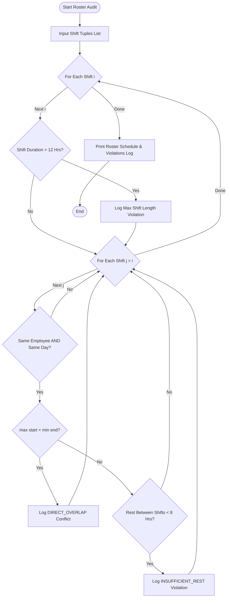

# Case Study 09: Tuple-Based Employee Shift Conflict Detection System

## 1. Problem Statement
Hospital and 24/7 industrial shift scheduling requires rigorous checks to prevent physician fatigue and labor regulation violations. Roster managers need an automated conflict detection engine that models shifts as immutable tuples `(shift_id, emp_id, emp_name, day, start_time, end_time, department)`, compares time intervals, flags temporal overlaps, and audits statutory rest periods.

## 2. Objectives
- Represent schedule assignments using structured tuples and apply tuple unpacking.
- Identify direct temporal overlaps where an employee is double-booked on the same day.
- Verify mandatory rest periods (minimum 8 hours between consecutive assignments).
- Flag shifts exceeding maximum daily shift lengths (12 hours).
- Output an itemized roster schedule and statutory violation audit log.

## 3. Assumptions
- Shift times are formatted as floating-point hours in 24-hour decimal notation (e.g. 14.5 represents 14:30).
- Shifts are contained within calendar day boundaries.
- Tuples are immutable and preserve data integrity during comparison traversals.

## 4. Algorithm
1. Receive shift roster as a list of tuples `(shift_id, emp_id, name, day, start, end, dept)`.
2. Iterate through each shift tuple $i$:
   a. Check if duration $(end - start) > \text{max\_daily\_hours}$; flag if violated.
   b. Compare against every subsequent shift $j$:
      - If `emp_id` and `day` match:
        - Compute interval overlap start: $\max(start_1, start_2)$.
        - Compute interval overlap end: $\min(end_1, end_2)$.
        - If $\text{overlap start} < \text{overlap end}$, record `DIRECT_OVERLAP`.
        - Else, compute rest period between non-overlapping shifts. If rest $< 8\text{ hrs}$, record `INSUFFICIENT_REST`.
3. Print formatted employee shift schedule.
4. Print flagged violations table with impacted shift IDs.

## 5. Flowchart


## 6. Pseudocode
```text
BEGIN
    FOR i FROM 0 TO N - 1 DO
        (id1, emp1, name1, day1, start1, end1, dept1) = shifts[i]
        IF (end1 - start1) > 12 THEN APPEND "MAX_HOURS_VIOLATION"
        
        FOR j FROM i + 1 TO N - 1 DO
            (id2, emp2, name2, day2, start2, end2, dept2) = shifts[j]
            IF emp1 == emp2 AND day1 == day2 THEN
                o_start = MAX(start1, start2)
                o_end = MIN(end1, end2)
                IF o_start < o_end THEN
                    APPEND "DIRECT_OVERLAP"
                ELSE
                    rest = ABS(start2 - end1) IF end1 <= start2 ELSE ABS(start1 - end2)
                    IF rest < 8.0 THEN APPEND "INSUFFICIENT_REST"
                END IF
            END IF
        END FOR
    END FOR
    DISPLAY Conflict Audit Report
END
```

## 7. Python Source Code
Refer to the complete script in [`shift_conflict_detection.py`](file:///c:/Users/Harsha/Downloads/New%20folder/Python-Activity-Based-Learning/Case_Study_09_Tuple_Shift_Conflict_Detection/shift_conflict_detection.py).

## 8. Test Cases
| Test ID | Employee | Shifts Tested | Expected Finding | Purpose |
| :--- | :--- | :--- | :--- | :--- |
| **TC-01** | Dr. Arvind Rao | `SH101` (8-16) vs `SH102` (14-20) | Direct Overlap (2.0 hrs) | Concurrent shift clash detection |
| **TC-02** | Nurse Sarah | `SH103` (7-15) vs `SH104` (18-23) | Insufficient Rest (3.0 hrs < 8.0) | Rest period validation |
| **TC-03** | Dr. Rohan Kapoor | `SH105` (8-22 = 14 hrs) | Max Hours Exceeded (14.0 hrs > 12.0) | Over-length shift restriction |
| **TC-04** | Tech Priya Sharma | `SH106` (Tue) vs `SH107` (Wed) | Clean (No Conflict) | Cross-day valid scheduling |

## 9. Sample Output Run
```text
=========================================================================================================
                     ENTERPRISE SHIFT ROSTER & CONFLICT AUDIT REPORT
=========================================================================================================
Compliance Policy: No Concurrent Shifts | Min Rest Period: 8.0 Hrs | Max Shift Hours: 12.0 Hrs/Day
---------------------------------------------------------------------------------------------------------
Shift ID   Emp ID   Employee Name      Day        Start    End      Duration   Department
---------------------------------------------------------------------------------------------------------
SH101      EMP01    Dr. Arvind Rao     Monday     8.00     16.00    8.0        Cardiology
SH102      EMP01    Dr. Arvind Rao     Monday     14.00    20.00    6.0        Emergency OPD
SH103      EMP02    Nurse Sarah Jones  Monday     7.00     15.00    8.0        Pediatrics
SH104      EMP02    Nurse Sarah Jones  Monday     18.00    23.00    5.0        ICU Night Duty
SH105      EMP03    Dr. Rohan Kapoor   Tuesday    8.00     22.00    14.0       Trauma Surgery
SH106      EMP04    Tech Priya Sharma  Tuesday    9.00     17.00    8.0        Pathology
SH107      EMP04    Tech Priya Sharma  Wednesday  9.00     17.00    8.0        Radiology
---------------------------------------------------------------------------------------------------------

[!] DETECTED ROSTER SCHEDULING CONFLICTS & VIOLATIONS:
Violation Type         Emp ID   Employee Name      Day        Conflict Details
---------------------------------------------------------------------------------------------------------
DIRECT_OVERLAP         EMP01    Dr. Arvind Rao     Monday     Shifts SH101 (Cardiology) and SH102 (Emergency OPD) overlap by 2.0 hours on Monday
INSUFFICIENT_REST      EMP02    Nurse Sarah Jones  Monday     Rest period between SH103 and SH104 is only 3.0 hrs (Required >= 8.0 hrs)
MAX_HOURS_VIOLATION    EMP03    Dr. Rohan Kapoor   Tuesday    Shift SH105 duration (14.0 hrs) exceeds maximum permitted limit (12.0 hrs)
=========================================================================================================
```

## 10. Conclusion
This case study demonstrates tuple unpacking, interval intersection algorithms, and multi-tier boundary evaluation to deliver an automated scheduling auditor matching labor compliance mandates.
